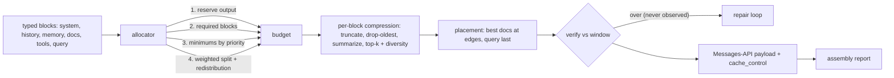

# p01 · Context Assembler Engine

> You master the context window, not fight it.

## The problem
Every agent turn is a packing problem: system prompt, conversation history, memories, retrieved documents, tool definitions and results, and the user's question, all competing for a finite window. Concatenating everything and truncating drops whatever came last, which is usually the newest turns or the question itself. And quality degrades long before the hard limit, especially for material buried in the middle.

## Architecture

- **Budget in priority order.** Output tokens are reserved first. Required blocks (system prompt, query) are protected. Optional blocks get their minimums in priority order, the remainder is split by weight, and tokens a block can't use are handed to blocks that lost content.
- **Compression is chosen per source.** History uses drop-oldest plus a summary of what was dropped, so a fact from turn 10 survives as a sentence instead of vanishing. Retrieval uses top-k by relevance with a diversity penalty. Tool results use middle-truncation, keeping the head and tail where errors usually live.
- **Placement against lost-in-the-middle.** The strongest documents go at the start and end of the evidence section, and the query always comes last.
- **Overflow can't happen.** The token estimate matches the measured payload exactly, and a verify-and-repair loop backs it up.
- **The output is ready to send.** It is a system prompt with `cache_control` on the stable prefix, alternating user/assistant messages and tools, plus a report of what was kept, compressed or dropped.

## Results

| Test | Result |
|---|---|
| Overflow over 250 randomized assemblies (3,000 more in a separate stress run) | **0** (repair loop never triggered) |
| Median window utilization when content had to be cut | 96.8% |
| **Retention:** 30 conversations of ~14k tokens squeezed into 4k, keeping needle doc + buried fact + query + system prompt | **100%** of cases |
| Same, naive head-truncation / tail-truncation | **0%** / **0%** |
| Same, sliding window instead of history summary | buried fact lost **every** time |
| Input token reduction vs sending full context | **78%** |
| Cost per 1k requests at Opus 5.5 input price | $12.03 vs $55.91 |
| Latency, ~59k tokens in → 8k / 32k / 200k window (p50) | 43.7 / 9.8 / 6.2 ms |

Latency is *inverse* to window size: a smaller window means more compression work. Even the worst case is a rounding error next to the model call it feeds.

## Why it matters
The 0% retention of naive truncation isn't a strawman: it is what happens by default in most agent loops. Each sliding-window variant keeps *some* of the four items. Only budget-aware, per-source compression keeps all four, and it does so while sending a fifth of the tokens.

## Limits
The offline summarizer is extractive. It keeps the right sentences, but an abstractive LLM summary (same interface, `LLMSummarizer`) compresses further. Token counts use the portfolio's conservative estimator, so real Claude tokenization will leave a little headroom unused.

See ADR-0002.
