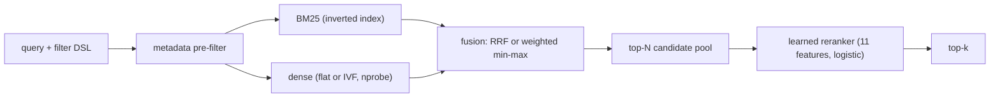

# p02 · Hybrid Reranking Retrieval Stack

> You build retrieval that actually finds things.

## The problem
Every RAG failure downstream starts as a retrieval miss. BM25 nails exact identifiers and rare terms but is blind to paraphrase; dense vectors handle paraphrase but blur exact matches. Rerankers fix ordering but cost scales with every candidate you feed them.

## Architecture

The reranker is a feature-based cross-encoder stand-in: BM25 (raw and relative), dense cosine, term and IDF-weighted coverage, bigram matches, proximity, fuzzy and title matches. It is trained with Newton's method on a held-out training split (120 train / 120 test queries over a 240-doc corpus). An `LLMReranker` uses the same interface.

## What the sweep shows (test split, 120 queries)

| Config | Recall@10 | MRR | p50 latency |
|---|---|---|---|
| BM25 only | 0.767 | 0.589 | 0.014 ms |
| Dense only (flat) | 0.700 | 0.604 | 0.074 ms |
| Hybrid RRF, pool 10 | 0.883 | 0.645 | 0.045 ms |
| Hybrid weighted 0.5, pool 50 | 0.892 | 0.725 | 0.089 ms |
| Hybrid + rerank top-10 | 0.892 | 0.860 | 0.24 ms |
| Hybrid + rerank top-40 | **0.992** | **0.952** | 0.56 ms |
| Hybrid (IVF nprobe=2) + rerank top-40 | 0.983 | 0.944 | 0.56 ms |

Takeaways:
- **Fusion buys recall, reranking buys precision.** Hybrid lifts Recall@10 by 12 points over the best single retriever. Reranking moves MRR from 0.72 to 0.95, meaning the right document lands at rank 1 almost every time.
- **Reranker pool size is the main latency knob.** Going from 10 to 40 candidates costs about 2.3x latency for +0.09 MRR. The sweep reports a Pareto frontier rather than one "best" config, because the right point depends on the latency SLO.
- **IVF loses little after reranking.** Approximate dense search drops ~1 point of recall once the reranker sees a wide enough pool, which is the classic reason to pair ANN with a reranker.
- **Learned weights are interpretable.** Title-fuzzy and IDF-coverage carry the most positive weight. Raw term coverage is negative once the other features are present, because collinear features trade off against each other.

## Tradeoffs and limits
- The corpus is synthetic but built adversarially: some queries can only be found by sparse search (codes, rare terms) and some only by dense search (paraphrase). Absolute numbers will be lower on real data; the *relative* ordering of configs is the transferable result.
- Pareto frontier membership depends on measured latency, so it is excluded from the reproducibility fingerprint. All accuracy metrics are bit-for-bit reproducible.

See ADR-0003.
