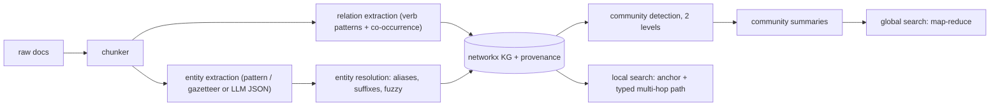

# p03 · GraphRAG Knowledge Pipeline

> You can make AI reason across connected data.

## The problem
"Who is the CEO of the company that acquired Lumen Labs?" Vector RAG retrieves chunks similar to the *question*, but the bridging entity (the acquirer) never appears in the question. So the second hop is retrieved by luck or not at all.

## Architecture

Every node and edge keeps the IDs of its source chunks, so each answer comes with the path it walked and the passages that justify each hop.

## Results (26 docs, 26 questions, 22 of them multi-hop)

| System | Overall acc. | Multi-hop acc. | 2-hop | 3-hop | Support-doc recall | Context tokens |
|---|---|---|---|---|---|---|
| Vector RAG top-3 | 0.27 | 0.14 | 0.13 | 0.17 | 0.58 | 176 |
| Vector RAG top-5 | 0.27 | 0.14 | 0.13 | 0.17 | 0.69 | 289 |
| **GraphRAG local** | **1.00** | **1.00** | **1.00** | **1.00** | **1.00** | **128** |

Index build: 38 nodes, 80 edges (54 typed, 26 co-occurrence), 10 then 7 communities, in about 13 ms.

Takeaways:
- **Widening k does not fix multi-hop.** Going from top-3 to top-5 raises support-doc recall (0.58 to 0.69), but answer accuracy stays flat at 0.14. The model needs the *chain*, not more chunks.
- **The graph uses *fewer* tokens.** A typed path plus its provenance chunks is a more compact context (128 tokens) than five similar-looking chunks (289 tokens).
- Single-hop questions are a tie (1.0 for both), so GraphRAG's advantage is specifically on connected reasoning.

## Honest caveats
- Extraction precision and recall against gold are both 1.0 because the bundled corpus is written in the relation patterns the offline extractor knows. On messy real text, the pattern extractor's recall would drop sharply, and the `LLMExtractor` path is the production choice. **The pipeline result to take away is "given a correct graph, multi-hop becomes trivial and explainable"**; extraction quality is the real bottleneck.
- At this scale networkx is fine. Past millions of edges you would move to a graph store, and the ADR records why we didn't.

See ADR-0004.
