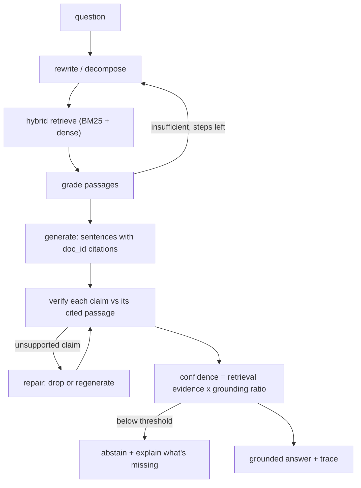

# p04 · Self-Correcting Agentic RAG

> You can stop RAG from confidently lying.

## The problem
A RAG system that answers every question will confidently answer the ones its corpus can't support. Users trust citations, so a citation that doesn't support its sentence is worse than no answer at all.

## Architecture

The claim verifier checks entity, number, unit and negation consistency between each sentence and its cited passage. The benchmark injects a deliberately hallucinating generator to test the verifier, not just the happy path.

## Results (48 questions: 24 answerable, 12 unanswerable, 12 adversarial × 5 runs)

| Metric | Value |
|---|---|
| Answer accuracy (answerable) | 1.00 |
| Abstention precision / recall (unanswerable) | 1.00 / 1.00 |
| Citation precision | 1.00 |
| Hallucination catch rate (140 injected claims) | **1.00** |
| Hallucinations leaked to final answer | **0** |
| Accuracy after repair under adversarial generator | 0.983 |
| Confidence Brier score | 0.0011 |
| False-flag rate on *paraphrased* true claims | **0.158** |
| Avg retrieval steps / rewrites issued | 1.67 / 24 |

The verifier catches all six mutation types: entity swap, number swap, unit swap, negation flip, mis-citation and fabrication.

## The weak spot, and why it's the right one
The verifier is lexical. When a true claim is heavily paraphrased, it fails about 16% of the time, and the system then repairs or drops a correct sentence. That is a deliberate asymmetry: **a false flag costs some recall, a missed hallucination costs trust.** Final answer accuracy on the paraphrase runs still recovers to 1.0 after repair. In production, the LLM-backed verifier (same interface) closes most of that gap.

## Caveat
The corpus and question set are synthetic and built to exercise each failure mode, which is why most scores are 1.0. The useful output is the *mechanism*: every claim is checked, every abstention is explained, and every step lands in a trace.

See ADR-0005.
