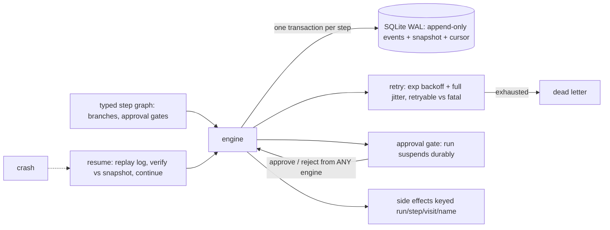

# p05 · Durable Agent State Machine

> You build agents that survive production failures.

## The problem
A research agent is four steps into a twenty-minute run when the pod is rescheduled. Restarting from scratch re-charges the card, re-sends the email and re-spends the tokens. Waiting two days for a human approval can't mean holding a process open for two days.

## Architecture

Three rules make it durable:
1. **Commit, then advance.** A step's event, the state snapshot and the cursor move commit in *one* SQLite transaction (WAL, `synchronous=FULL`), so there is no window where the log and the state disagree.
2. **Replay, don't re-run.** On resume, completed steps return their recorded outputs. The engine refuses to resume if the replayed log disagrees with the snapshot, so it fails loudly instead of continuing with corrupted state.
3. **Idempotency keys on every side effect.** A crash *after* an external call but *before* the commit makes the step re-run. The key `run/step/visit/name` lets the external system deduplicate the repeated call.

## Results: 200 workflows, 112 injected crashes, 122 injected transient failures

| Metric | Value |
|---|---|
| Completion rate | **1.00** |
| Duplicate side effects | **0** (600 / 600 applied exactly once) |
| External calls re-sent after a crash and deduplicated by key | 24 |
| Mean retries per workflow | 0.61 |
| Recovery time mean / p95 | ~2 ms / ~4 ms |
| Checkpoint overhead per step | ~0.2 ms (fsync'd) vs 0.08 ms in-memory |
| **Real `SIGKILL` / `os._exit` of a worker process** | 3 / 3 completed, 0 duplicates, ~110 ms to resume |

The "24 re-sent calls" row is the important one: a crash between an external call and the commit is unavoidable. Exactly-once *execution* is impossible, so the design target is exactly-once *effect*, achieved with at-least-once execution plus idempotency keys.

## Human-in-the-loop
The sample research agent (plan → search → draft → **human review** → publish → notify) suspends in `WAITING_APPROVAL`. A *different* engine instance later approves it, and an unauthorized approver is refused. Approvals that time out escalate. No process stays alive while waiting.

## Tradeoffs
SQLite allows one writer at a time. That is right for an agent control plane (low step rates, strong guarantees, zero ops) and wrong for a high-fan-out job queue. The store sits behind an interface, so moving to Postgres is a change to that one layer. Full `fsync` roughly triples per-step overhead, which is still under a millisecond and negligible next to a single LLM call.

See ADR-0006.
