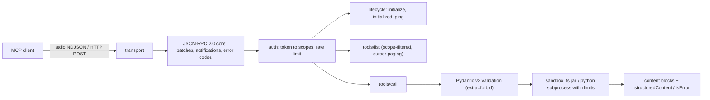

# p06 · Raw MCP Tool Server

> You understand tooling at the protocol level.

## The problem
SDKs make MCP feel like magic, and magic hides the details that page you at 3 a.m. For example: whether a bad argument is a JSON-RPC protocol error or a tool error the model can recover from, how capabilities are negotiated, who is allowed to see which tool, and what stops `../../etc/passwd`.

## Architecture

No MCP SDK is used: framing, dispatch, schema generation and the lifecycle are all implemented directly. Tool input schemas are generated from Pydantic models, so the schema the model sees cannot drift from the code that validates it.

## The error-boundary decision
- **Malformed request or invalid params** → JSON-RPC error (`-32600` / `-32602`). The *client* is broken.
- **Valid call that fails inside the tool** → a normal result with `isError: true`. The *model* can read the message and try again.

Getting this split wrong is the most common MCP server bug. The benchmark's 54-case fuzz set checks it, and the server answers all 54 correctly.

## Results

| Metric | Value |
|---|---|
| `tools/call` in-process | ~79k req/s |
| `tools/call` over stdio, sequential | ~35k req/s |
| `tools/call` over stdio, pipelined | ~67k req/s |
| Malformed-request fuzz cases handled correctly | 54 / 54 |
| Sandbox escape attempts blocked | **29 / 29** (10 filesystem, 19 python-exec) |

Escape attempts include path traversal, symlinks pointing outside the jail, absolute paths, reading environment variables, network access, fork bombs, memory bombs, infinite loops and oversized output.

## Tradeoffs
- The python-exec sandbox uses process isolation plus `setrlimit`, an empty environment and a temp working directory. That is fine for defense in depth, but it is **not** a security boundary against a determined attacker. Production would add a container or gVisor/Firecracker. The tool interface stays the same.
- We own spec conformance: a protocol revision means code changes here, whereas an SDK user would just bump a version.

See ADR-0007.
