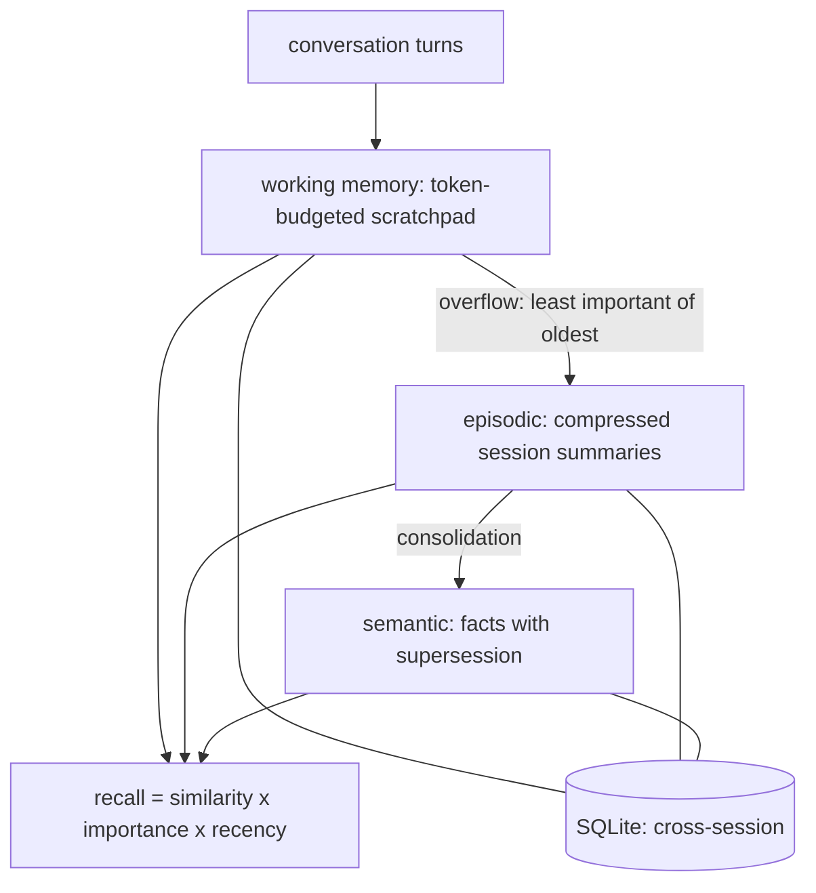

# p07 · 3-Tier Memory System

> You can build agents that truly remember.

## The problem
"I moved to Lisbon" should beat "I live in Paris" from three weeks ago. A flat vector store of everything the user ever said recalls both and can't tell which is current. Stuffing whole transcripts into context doesn't scale past a few sessions.

## Architecture

- **Importance** combines explicit salience cues ("remember that…"), keyword and emotion cues, access frequency, and exponential recency decay.
- **Supersession**: a new fact on the same slot (location, employer…) retires the old one instead of competing with it. Retractions are handled too.
- **TTL per tier**, with an injectable clock so tests can fast-forward 35 days.
- **Persistence** is tested across both a fresh `MemoryManager` and a separate OS process.

## Results: 4 sessions, 38 turns, 12 probes, queried on day 35 from a fresh process

| Metric | 3-tier memory | Flat vector store |
|---|---|---|
| precision@1 | **0.833** | 0.417 |
| recall@3 | **1.00** | 0.75 |
| MRR@5 | **0.903** | 0.590 |
| Stale fact outranks current | **0 / 2** | 2 / 2 |

Episodic compression keeps 37% of the original tokens. Over the run, 18 working-memory items were evicted to episodic, 3 episodes expired by TTL, and 2 superseded facts were purged.

(precision@3 looks low at 0.39 only because most probes have a single correct memory; recall@3 = 1.0 is the meaningful number.)

## What moved the needle
Removing the conversational boilerplate ("user", "my") before embedding lifted precision@1 from 0.67 to 0.83. The cheapest retrieval win is usually input hygiene, not a better model.

## Limits
The importance weights are hand-tuned on the scripted benchmark, not learned. The fact extractor is pattern-based offline; the LLM path covers open-ended facts.

See ADR-0008.
