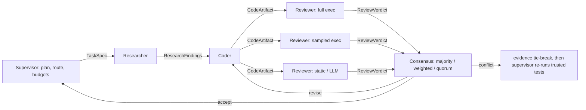

# p08 · Typed Multi-Agent Swarm

> You orchestrate swarms, not fragile single agents.

## The problem
Multi-agent systems fail in two quiet ways. A malformed handoff propagates three agents downstream before anything crashes. And a review step where agents *agree* with each other gives you consensus without evidence, so one confidently wrong reviewer can ship broken code.

## Architecture

- **Typed at two levels.** Messages are Pydantic models with *semantic* validators: a `CodeArtifact` must define the requested function, and a `ReviewVerdict` cannot approve while its own test results show failures. The topology graph is type-checked before anything runs, so wiring a `CodeArtifact` into a node that doesn't accept one fails at build time with `CodeArtifact is not accepted by panel`.
- **Repair before crash.** An invalid agent output goes back to the LLM with the validation error for repair, and then falls back to the offline algorithm.
- **The offline coder is real.** It runs a counterexample-guided search over a library of candidate programs plus AST mutations. It found the `lo <= hi` binary-search fix by mutation.
- **Reviewers execute.** Generated code runs against tests in a subprocess sandbox with per-test timeouts.

## Results: 15 spec tasks

| Configuration | Task success | Verdict accuracy | Avg tokens |
|---|---|---|---|
| Single agent | 0.00 | – | 330 |
| Swarm, one reviewer | 0.93 | 1.00 | 2,344 |
| Swarm, 3-reviewer consensus | 0.93 | 1.00 | 3,522 |

**With one adversarial reviewer injected** (it fabricates test results):

| Configuration | Task success | Verdict accuracy |
|---|---|---|
| Adversary is the only reviewer | **0.00** (wrong code approved every time) | 0.00 |
| Majority vote, no conflict resolution | 0.93 | 0.94 |
| Majority + evidence tie-break | 0.93 | **1.00** |
| Weighted by track record | 0.93 | **1.00** (only 4 escalations, against 18 for plain majority) |

What the numbers say:
- **Review is where the value is.** A single agent picks the simplest candidate that passes the spec's two examples and misses an edge case on every task. Adding a reviewer that *executes* tests takes success from 0 to 93%.
- **Consensus is insurance, not accuracy.** With honest reviewers, three of them buy nothing over one and cost 50% more tokens. Their value appears only when a reviewer is faulty, where they turn 100% wrong approvals into 0.
- **Weighting by track record cuts escalations by 4.5x**, because the adversary's vote quickly loses weight. That is cheaper than re-running tests on every disagreement.

## The one failure, kept on purpose
Every swarm configuration ships one wrong function: a leap-year task where the bundled research note omits the 400-year rule, so 2000 is misclassified. All reviewers agree because they share the same wrong premise. **Consensus can't fix correlated errors that come from shared context**, and only independent evidence can. A test shows that a reviewer with the correct rule catches it.

See ADR-0009.
