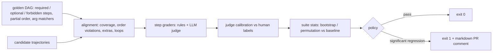

# p09 · Trajectory Eval CI Gate

> You grade the journey, not just the answer.

## The problem
An agent that refunds the right order *without checking authorization* passes an answer-only eval. And agent runs are noisy, so a naive "mean score dropped" gate blocks half your PRs for nothing.

## Architecture

The CLI (`python -m trajectory_eval gate --baseline … --candidate … --policy …`) ships with a GitHub Actions workflow in `ci/`.

## Results

**Grading:** 200 trajectories (1,936 steps) at about 11k trajectories/s. DAG alignment agrees with ground truth 100% of the time.

**Judge calibration** (160 human labels, 5-fold cross-validated):

| | Before | After Platt | After isotonic |
|---|---|---|---|
| Cohen's κ | 0.00 | 0.53 | 0.53 |
| Accuracy | 0.44 | 0.76 | 0.76 |
| ECE | 0.45 | 0.11 | 0.11 |

The raw heuristic judge scores *everything* high (mean 0.95 on good steps, 0.85 on bad), so at a naive 0.5 threshold its agreement is chance-level. The signal is there, but the scale is wrong. Calibration is what makes a judge usable, and it can only be done against human labels.

**Regression detection** (64 scenarios: 32 noise-only, 32 with an injected regression, 80 runs per suite):

| Gate | Precision | Recall | False-positive rate |
|---|---|---|---|
| Naive mean-delta threshold | 0.67 | 1.00 | **0.50** |
| Statistical gate | **1.00** | 0.94 | **0.00** |

The naive gate would block half of all harmless PRs. The statistical gate never does, and it misses 2 of 32 injected regressions; both are "forbidden action" injections that occur in only a small fraction of runs (recall 0.75 for that class). **Hard-policy rules (any forbidden tool call → block) exist precisely for that class**: some regressions must block on a single occurrence, not on statistics.

See ADR-0010.
