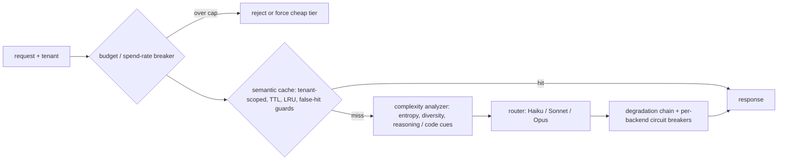

# p11 · Semantic Cache + Routing Gateway

> You can slash inference costs by 40-60%.

## The problem
Sending every request to the most capable model is the simplest policy and the most expensive one. Real traffic is full of easy prompts and near-duplicate paraphrases. Provider incidents and runaway tenants need to degrade the service, not take it down or drain the budget.

## Architecture

**False-hit guards** matter more than hit rate. "What's 15% of 80?" must not return the cached answer for "What's 15% of 90?". The cache refuses near-matches whose numbers, negations or antonyms differ, or where the same template is filled with a different entity (e.g. Go vs Rust).

## Results: replay of 500 requests (161 distinct intents)

| Metric | Value |
|---|---|
| Cost, always-Opus baseline | $0.509 |
| Cost, gateway | $0.134 |
| **Savings** | **73.7%** |
| Savings from routing alone / caching alone | 58.5% / 46.8% |
| Cache hit rate | 47.4% |
| **Cache false hits** | **0** |
| Routing agreement with labels | 99.6% |
| Simulated latency p50 / p95 | 317 / 1,625 ms |

**Under injected failures** (Opus outage plus Sonnet errors): 99.8% of requests still succeed, with 70 fallbacks; the open Opus breaker skipped 45 calls that would otherwise have waited to time out.

**Kill-switch:** a tenant capped at $0.005 spent $0.004996, with 44 requests rejected and 2 spend-rate breaker trips. The cap holds because cost is estimated *before* the call, not reconciled after it.

## Tradeoffs
- The main quality risk is routing a hard prompt to a small model. The thresholds are tuned conservatively, and routing agreement is reported as a first-class metric next to savings.
- Routing and caching don't add up (58.5% + 46.8% ≠ 73.7%), because cache hits remove requests that routing would already have made cheap.

See ADR-0012.
